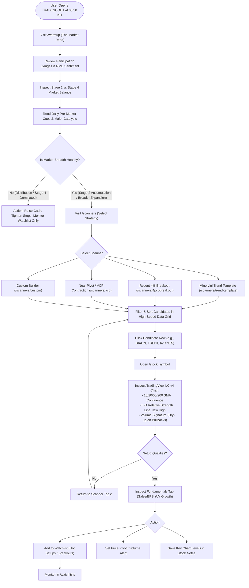
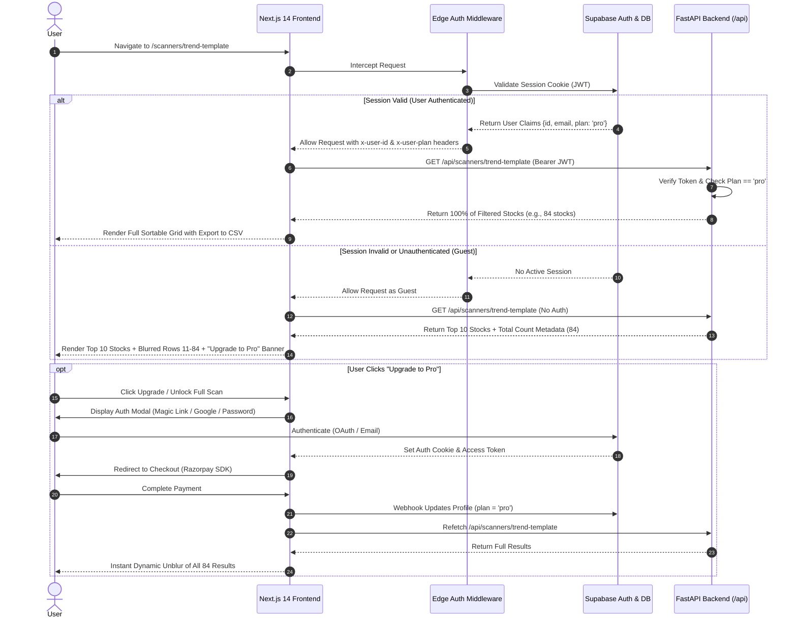

# TRADESCOUT — Application User Flow & Journey Specification

> **Version:** 1.0.0  
> **Target Platform:** Next.js 14 App Router (Desktop & Mobile Responsive)  
> **Primary Audience:** Retail Swing Traders, Minervini Trend Template Investors, CANSLIM Momentum Traders

---

## 1. Executive Summary & Navigation Topology

TRADESCOUT is an end-to-end scanning, market breadth diagnostics, and technical charting application built specifically for Indian equity markets (NSE/BSE). The user experience prioritizes rapid morning market assessment ("The Warmup"), effortless multi-criteria filtering ("Scanners"), frictionless technical drilldowns ("Stock Detail & TradingView Charts"), and personal watchlist curation.

### 1.1 Complete Route Sitemap

| Route Path | Access Level | Description | Core Dependencies |
| :--- | :--- | :--- | :--- |
| `/` | Public | Marketing landing page, platform overview, sample scanner preview, CTA | Static / ISR |
| `/warmup` | Public (Top 10) / Member (Full) | Morning market readiness dashboard: gauges, sentiment, Stage balance, cues | `/api/metadata`, `/api/cues`, `/api/market-breadth` |
| `/scanners` | Public | Directory of all pre-built and custom market scans | `/api/metadata` |
| `/scanners/:slug` | Public (Top 10) / Pro (Full) | High-performance interactive scanner table (e.g., `trend-template`, `vcp`) | `/api/scanners/:slug` |
| `/scanners/custom` | Pro Only | Visual query builder for technical & fundamental criteria | `/api/scan/options`, `/api/scan` |
| `/stock/:symbol` | Public | Comprehensive stock technical view, TradingView charts, RS line, concalls | `/api/stock/:symbol/*` |
| `/markets` | Public | Index performance (Nifty 50, Next 50, Midcap 150, Smallcap 250) | `/api/indices` |
| `/groups` | Public | Industry groups & sector rotation rankings | `/api/sectors` |
| `/heatmap` | Public | Market-cap weighted visual performance treemap | `/api/sectors`, `/api/metadata` |
| `/leaders` | Public | True market leaders ranked by IBD-style 12-month Relative Strength (RS) | `/api/scanners/trend-template` |
| `/rrg` | Member / Pro | Relative Rotation Graph (Leading, Weakening, Lagging, Improving quadrants) | Vectorized RS-Ratio & RS-Momentum API |
| `/results` | Public | Earnings calendar with historical surprise metrics and consensus dates | `/api/scan/earnings-calendar` |
| `/news` | Public | Real-time regulatory filings, market catalysts, corporate disclosures | `/api/catalysts` |
| `/watchlists` | Authenticated | User watchlists with mini sparklines, batch tagging, notes | Supabase PostgreSQL + RLS |
| `/intraday` | Pro Only | Real-time intraday breadth, 5m/15m volume surges, VWAP breakouts | `/api/live/dashboard` |
| `/login` | Public | Supabase Auth: Email/Password, Magic Link, Google OAuth | Supabase Auth SDK |
| `/signup` | Public | Registration with plan selection (Free vs Pro) | Supabase Auth SDK |
| `/account` | Authenticated | Profile management, subscription management (Razorpay), billing invoices | Supabase Auth + Profiles |
| `/settings` | Authenticated | Platform preferences: default chart indicators, dark/light theme, alert webhooks | `ui_prefs` table |

---

## 2. Core User Flows & State Machines

### 2.1 The Daily Trading Workflow (The "Warmup to Trade" Loop)



---

### 2.2 Detailed Authentication & Role Gating Flow

TRADESCOUT employs a non-blocking freemium model. Free users gain access to high-value market reads and top 10 scanner candidates. Advanced multi-stage filters and deep history are unlocked with TRADESCOUT Pro.



---

## 3. Screen-by-Screen Interaction Specifications

### 3.1 The Warmup Dashboard (`/warmup`)

The Warmup screen acts as the pilot cockpit before market hours (09:15 IST).

#### Layout Structure:
1. **Header Bar:**
   - Real-time Market Status Indicator (`OPEN`, `CLOSED`, `PRE-MARKET`).
   - Last EOD Sync Timestamp (e.g., `"Data updated: 12 Nov 2026 16:30 IST"`).
   - Advance/Decline Ratio Pill (`1,420 Adv / 680 Dec`).
2. **Top Diagnostic Row (3 Stat Cards):**
   - **Market Participation Gauge:** Radial gauge charting percentage of NSE 500 stocks above 50-day SMA.
   - **RME Sentiment Gauge:** Proprietary Risk Metric Engine scale (Washed Out / Neutral / Optimistic / Overextended).
   - **Stage 2 vs Stage 4 Ratio:** Bar visualization comparing stocks in confirmed Stage 2 Markup vs Stage 4 Markdown.
3. **Middle Section (Split View):**
   - **Left Column (Market Breadth Breakdown):**
     - Stocks hitting new 52-week Highs vs 52-week Lows (Historical 20-day bar chart).
     - Net Volume Flow (Up volume vs Down volume).
   - **Right Column (Daily Market Cues & Catalysts):**
     - Global Market summary (Gift Nifty, US Markets, Crude Oil, DXY).
     - Macro announcements, RBI rate decisions, block deals.
4. **Bottom Section (Earnings Horizon):**
   - Interactive calendar ribbon of companies reporting quarterly results this week. Filterable by Market Cap (>₹5,000 Cr).

---

### 3.2 High-Performance Scanner Grid (`/scanners/:slug`)

Designed for instant sorting and filtering of 2,500+ NSE symbols without DOM thrashing.

#### Interaction Details:
- **Zero-Latency Search:** Symbol & company name instant filtering (<10ms via memory indexing).
- **Column Sorting:** Multi-column sorting (e.g., Sort by `RS Rating` descending, then `RVOL` descending).
- **Sticky Column:** Symbol and CMP columns freeze on horizontal scroll for mobile and laptop viewports.
- **Micro-Sparklines:** Inline 20-day price trend mini-charts rendered on lightweight HTML5 Canvas.
- **Keyboard Navigation:**
  - `ArrowDown` / `ArrowUp`: Move highlight across stocks.
  - `Spacebar`: Toggle stock into active quick-preview drawer.
  - `Enter`: Navigate directly to `/stock/:symbol`.
  - `W`: Toggle quick-add to default Watchlist.
- **Export Utility:** Pro members can export filtered results to CSV or TradingView ticker format (`NSE:RELIANCE, NSE:TRENT, NSE:DIXON`).

---

### 3.3 Stock Detail Page (`/stock/:symbol`)

The core analytical hub featuring a financial-grade TradingView Lightweight Charts canvas.

```
+------------------------------------------------------------------------------------+
| [← Back] RELIANCE (Reliance Industries Ltd) | CMP: ₹1,274.50 (+1.85%) | RS: 88    |
| Sector: Oil & Gas / Retail | Stage: 2 (Markup) | 52W Range: ₹1,050 - ₹1,320        |
+------------------------------------------------------------------------------------+
| [Chart View]  [RS Line vs Nifty]  [Fundamentals]  [Quarterly Results]  [Concalls]  |
+-------------------------------------------------------------------+----------------+
| TRADINGVIEW LIGHTWEIGHT CHARTS V4 CANVAS                          | SIDEBAR INFO   |
|                                                                   | -------------- |
| Indicators Active: [SMA 10] [SMA 20] [SMA 50] [SMA 200] [Volume]  | Key Metrics:   |
|                                                                   | P/E: 24.2      |
| [===============================================================] | ROE: 14.8%     |
| [  Candlestick Series with Dynamic Stage Shading                ] | ROCE: 12.1%    |
| [  Pivot Breakout Dashed Overlay Line                           ] | D/E: 0.38      |
| [===============================================================] |                |
| Volume Histogram with 50-day Avg Line & High-Volume Climax Spikes | Promoter: 50.3%|
| ----------------------------------------------------------------- | FII: 22.4%     |
| Sub-Pane: RSI (14) & Relative Strength Line (vs NIFTY 50)         | DII: 16.8%     |
+-------------------------------------------------------------------+----------------+
| QUICK ACTIONS:  [+ Add to Watchlist]  [🔔 Set Alert]  [📝 Add Note]  [🔗 Share Chart] |
+------------------------------------------------------------------------------------+
```

#### Multi-Tab Content Engine:
1. **Chart View:** Full OHLCV, volume profile, moving average clouds, pivot markers.
2. **RS Line:** Normalized 1-year relative strength performance indexed against Nifty 50. Upward sloping RS line during index corrections signals institutional accumulation.
3. **Fundamentals:** Screener-style 5-year financials: Sales YoY growth, Operating Profit Margin (OPM %), Net Profit, EPS trajectory.
4. **Concalls & Filings:** PDF links and key takeaways from corporate investor presentations and conference calls.
5. **Private Notes:** Persisted user journal entries stored in Supabase with instant auto-save.

---

### 3.4 Relative Rotation Graph (`/rrg`)

A visual framework for assessing sector and theme rotation dynamics.

#### Interaction Mechanics:
- **Axes Definition:**
  - X-Axis: **JdK RS-Ratio** (Measures relative trend strength against benchmark).
  - Y-Axis: **JdK RS-Momentum** (Measures rate of change of relative strength).
- **Four Quadrants:**
  - **Leading (Top-Right, Green):** Outperforming benchmark with strong positive momentum.
  - **Weakening (Bottom-Right, Yellow):** Outperforming benchmark but losing momentum.
  - **Lagging (Bottom-Left, Red):** Underperforming benchmark with negative momentum.
  - **Improving (Top-Left, Blue):** Underperforming benchmark but gaining upward momentum (Watch for early rotation).
- **Interactive Trajectory Tails:** Users can toggle trail lengths (5, 10, or 20 trading sessions) to visualize rotational velocity clockwise across quadrants.

---

## 4. Mobile Responsiveness & Touch Patterns

1. **Adaptive Navigation:**
   - Desktop: Persistent left-hand collapsible sidebar with keyboard shortcuts.
   - Mobile: Clean bottom tab bar (`Warmup`, `Scanners`, `Watchlist`, `Search`, `Account`).
2. **Touch-Optimized Chart Controls:**
   - Single finger drag: Crosshair inspection with price/date pill.
   - Pinch-to-zoom: X-axis time dilation.
   - Long-press: Contextual menu to set alert or flag symbol.
3. **Data Grid Virtualization:**
   - Mobile scanner displays condensed cards with swipe-to-watchlist gestures, while desktops render dense 15-column virtualized data tables.

---

## 5. Offline Capabilities & Degraded State Handling

| Failure Scenario | UI/UX Degradation Strategy | User Communication |
| :--- | :--- | :--- |
| **User Loses Internet Connectivity** | Cache current scanner results & watchlist in `IndexedDB`. Display offline banner. Allow chart viewing from cached candlesticks. | *"You are currently offline. Viewing cached EOD data."* |
| **TejHQ Parquet Update Delayed at 16:00 IST** | Backend gracefully serves previous day's completed cache. Yellow status badge appears. | *"NSE EOD Bhavcopy processing. Displaying data as of yesterday."* |
| **Supabase Outage (Auth/DB down)** | Read-only scanner and chart features remain 100% functional via anonymous edge caching. Personal watchlists show fallback local storage. | *"Cloud sync temporarily unavailable. Local changes saved."* |
