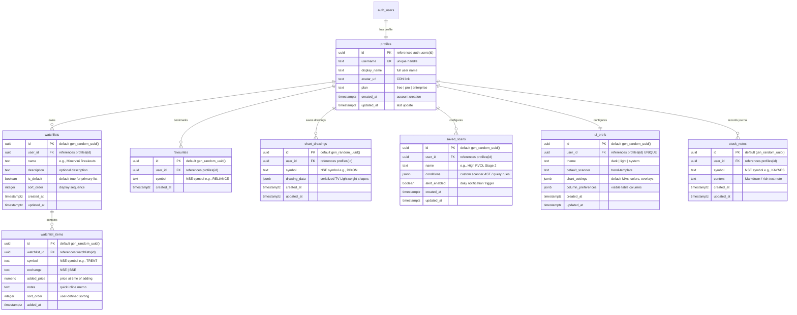

# TRADESCOUT — Backend Database Schema Specification

> **Database Engine:** Supabase PostgreSQL 15+ / 16  
> **Security Model:** Row Level Security (RLS) enabled on all user tables  
> **ORM & Access Layer:** Async SQLAlchemy 2.0 (FastAPI) + Supabase JS Client (Next.js)

---

## 1. Entity-Relationship Architecture Diagram



---

## 2. Complete Supabase DDL SQL Scripts

Save this script as `supabase/migrations/20261113000000_init_tradescout_schema.sql`:

```sql
-- ============================================================================
-- TRADESCOUT DATABASE MIGRATION SCRIPT
-- Generated for PostgreSQL 15+ / Supabase
-- ============================================================================

-- Enable required extensions
CREATE EXTENSION IF NOT EXISTS "uuid-ossp";
CREATE EXTENSION IF NOT EXISTS "pgcrypto";

-- ============================================================================
-- 1. PROFILES TABLE (Extensions to Supabase auth.users)
-- ============================================================================
CREATE TABLE IF NOT EXISTS public.profiles (
    id UUID PRIMARY KEY REFERENCES auth.users(id) ON DELETE CASCADE,
    username TEXT UNIQUE,
    display_name TEXT,
    avatar_url TEXT,
    plan TEXT NOT NULL DEFAULT 'free' CHECK (plan IN ('free', 'pro', 'enterprise')),
    stripe_customer_id TEXT,
    razorpay_customer_id TEXT,
    subscription_status TEXT DEFAULT 'inactive',
    created_at TIMESTAMPTZ NOT NULL DEFAULT TIMEZONE('utc'::text, NOW()),
    updated_at TIMESTAMPTZ NOT NULL DEFAULT TIMEZONE('utc'::text, NOW())
);

ALTER TABLE public.profiles ENABLE ROW LEVEL SECURITY;

CREATE POLICY "Public profiles are viewable by everyone."
    ON public.profiles FOR SELECT USING (true);

CREATE POLICY "Users can update their own profile."
    ON public.profiles FOR UPDATE USING (auth.uid() = id);

-- ============================================================================
-- 2. WATCHLISTS TABLE
-- ============================================================================
CREATE TABLE IF NOT EXISTS public.watchlists (
    id UUID PRIMARY KEY DEFAULT gen_random_uuid(),
    user_id UUID NOT NULL REFERENCES public.profiles(id) ON DELETE CASCADE,
    name TEXT NOT NULL,
    description TEXT,
    is_default BOOLEAN NOT NULL DEFAULT false,
    sort_order INTEGER NOT NULL DEFAULT 0,
    created_at TIMESTAMPTZ NOT NULL DEFAULT TIMEZONE('utc'::text, NOW()),
    updated_at TIMESTAMPTZ NOT NULL DEFAULT TIMEZONE('utc'::text, NOW())
);

ALTER TABLE public.watchlists ENABLE ROW LEVEL SECURITY;

CREATE POLICY "Users can CRUD their own watchlists."
    ON public.watchlists FOR ALL USING (auth.uid() = user_id);

CREATE INDEX idx_watchlists_user_id ON public.watchlists(user_id);

-- Enforce free tier constraint: Max 1 watchlist for free tier
CREATE OR REPLACE FUNCTION check_watchlist_tier_limit()
RETURNS TRIGGER AS $$
DECLARE
    user_plan TEXT;
    watchlist_count INTEGER;
BEGIN
    SELECT plan INTO user_plan FROM public.profiles WHERE id = NEW.user_id;
    IF user_plan = 'free' THEN
        SELECT COUNT(*) INTO watchlist_count FROM public.watchlists WHERE user_id = NEW.user_id;
        IF watchlist_count >= 1 THEN
            RAISE EXCEPTION 'Free plan limit reached: Maximum 1 watchlist allowed. Please upgrade to Pro.';
        END IF;
    END IF;
    RETURN NEW;
END;
$$ LANGUAGE plpgsql SECURITY DEFINER;

CREATE TRIGGER trg_check_watchlist_tier
    BEFORE INSERT ON public.watchlists
    FOR EACH ROW EXECUTE FUNCTION check_watchlist_tier_limit();

-- ============================================================================
-- 3. WATCHLIST_ITEMS TABLE
-- ============================================================================
CREATE TABLE IF NOT EXISTS public.watchlist_items (
    id UUID PRIMARY KEY DEFAULT gen_random_uuid(),
    watchlist_id UUID NOT NULL REFERENCES public.watchlists(id) ON DELETE CASCADE,
    symbol TEXT NOT NULL,
    exchange TEXT NOT NULL DEFAULT 'NSE',
    added_price NUMERIC(12, 2),
    notes TEXT,
    sort_order INTEGER NOT NULL DEFAULT 0,
    added_at TIMESTAMPTZ NOT NULL DEFAULT TIMEZONE('utc'::text, NOW()),
    CONSTRAINT uq_watchlist_symbol UNIQUE (watchlist_id, symbol)
);

ALTER TABLE public.watchlist_items ENABLE ROW LEVEL SECURITY;

CREATE POLICY "Users can manage items in their own watchlists."
    ON public.watchlist_items FOR ALL USING (
        EXISTS (
            SELECT 1 FROM public.watchlists w
            WHERE w.id = watchlist_items.watchlist_id
            AND w.user_id = auth.uid()
        )
    );

CREATE INDEX idx_watchlist_items_watchlist_id ON public.watchlist_items(watchlist_id);
CREATE INDEX idx_watchlist_items_symbol ON public.watchlist_items(symbol);

-- Enforce free tier constraint: Max 20 items per list for free tier
CREATE OR REPLACE FUNCTION check_watchlist_items_tier_limit()
RETURNS TRIGGER AS $$
DECLARE
    user_plan TEXT;
    items_count INTEGER;
    v_user_id UUID;
BEGIN
    SELECT user_id INTO v_user_id FROM public.watchlists WHERE id = NEW.watchlist_id;
    SELECT plan INTO user_plan FROM public.profiles WHERE id = v_user_id;
    
    IF user_plan = 'free' THEN
        SELECT COUNT(*) INTO items_count FROM public.watchlist_items WHERE watchlist_id = NEW.watchlist_id;
        IF items_count >= 20 THEN
            RAISE EXCEPTION 'Free plan limit reached: Maximum 20 stocks per watchlist. Please upgrade to Pro.';
        END IF;
    END IF;
    RETURN NEW;
END;
$$ LANGUAGE plpgsql SECURITY DEFINER;

CREATE TRIGGER trg_check_watchlist_items_tier
    BEFORE INSERT ON public.watchlist_items
    FOR EACH ROW EXECUTE FUNCTION check_watchlist_items_tier_limit();

-- ============================================================================
-- 4. FAVOURITES TABLE
-- ============================================================================
CREATE TABLE IF NOT EXISTS public.favourites (
    id UUID PRIMARY KEY DEFAULT gen_random_uuid(),
    user_id UUID NOT NULL REFERENCES public.profiles(id) ON DELETE CASCADE,
    symbol TEXT NOT NULL,
    created_at TIMESTAMPTZ NOT NULL DEFAULT TIMEZONE('utc'::text, NOW()),
    CONSTRAINT uq_user_favourite_symbol UNIQUE (user_id, symbol)
);

ALTER TABLE public.favourites ENABLE ROW LEVEL SECURITY;

CREATE POLICY "Users can manage their own favourites."
    ON public.favourites FOR ALL USING (auth.uid() = user_id);

CREATE INDEX idx_favourites_user_id ON public.favourites(user_id);

-- ============================================================================
-- 5. CHART_DRAWINGS TABLE (TradingView serialized state)
-- ============================================================================
CREATE TABLE IF NOT EXISTS public.chart_drawings (
    id UUID PRIMARY KEY DEFAULT gen_random_uuid(),
    user_id UUID NOT NULL REFERENCES public.profiles(id) ON DELETE CASCADE,
    symbol TEXT NOT NULL,
    drawing_data JSONB NOT NULL DEFAULT '{}'::jsonb,
    created_at TIMESTAMPTZ NOT NULL DEFAULT TIMEZONE('utc'::text, NOW()),
    updated_at TIMESTAMPTZ NOT NULL DEFAULT TIMEZONE('utc'::text, NOW()),
    CONSTRAINT uq_user_symbol_drawings UNIQUE (user_id, symbol)
);

ALTER TABLE public.chart_drawings ENABLE ROW LEVEL SECURITY;

CREATE POLICY "Users can CRUD their own chart drawings."
    ON public.chart_drawings FOR ALL USING (auth.uid() = user_id);

CREATE INDEX idx_chart_drawings_user_symbol ON public.chart_drawings(user_id, symbol);

-- ============================================================================
-- 6. SAVED_SCANS TABLE (Custom Scanner filters)
-- ============================================================================
CREATE TABLE IF NOT EXISTS public.saved_scans (
    id UUID PRIMARY KEY DEFAULT gen_random_uuid(),
    user_id UUID NOT NULL REFERENCES public.profiles(id) ON DELETE CASCADE,
    name TEXT NOT NULL,
    conditions JSONB NOT NULL DEFAULT '{}'::jsonb,
    alert_enabled BOOLEAN NOT NULL DEFAULT false,
    created_at TIMESTAMPTZ NOT NULL DEFAULT TIMEZONE('utc'::text, NOW()),
    updated_at TIMESTAMPTZ NOT NULL DEFAULT TIMEZONE('utc'::text, NOW())
);

ALTER TABLE public.saved_scans ENABLE ROW LEVEL SECURITY;

CREATE POLICY "Users can CRUD their own saved scans."
    ON public.saved_scans FOR ALL USING (auth.uid() = user_id);

CREATE INDEX idx_saved_scans_user_id ON public.saved_scans(user_id);

-- ============================================================================
-- 7. UI_PREFS TABLE (Personalization & Chart Defaults)
-- ============================================================================
CREATE TABLE IF NOT EXISTS public.ui_prefs (
    id UUID PRIMARY KEY DEFAULT gen_random_uuid(),
    user_id UUID NOT NULL UNIQUE REFERENCES public.profiles(id) ON DELETE CASCADE,
    theme TEXT NOT NULL DEFAULT 'dark' CHECK (theme IN ('dark', 'light', 'system')),
    default_scanner TEXT NOT NULL DEFAULT 'trend-template',
    chart_settings JSONB NOT NULL DEFAULT '{
        "sma10": true,
        "sma20": true,
        "sma50": true,
        "sma200": true,
        "volume": true,
        "rsi": false,
        "rsLine": true
    }'::jsonb,
    column_preferences JSONB NOT NULL DEFAULT '[]'::jsonb,
    created_at TIMESTAMPTZ NOT NULL DEFAULT TIMEZONE('utc'::text, NOW()),
    updated_at TIMESTAMPTZ NOT NULL DEFAULT TIMEZONE('utc'::text, NOW())
);

ALTER TABLE public.ui_prefs ENABLE ROW LEVEL SECURITY;

CREATE POLICY "Users can manage their own UI preferences."
    ON public.ui_prefs FOR ALL USING (auth.uid() = user_id);

-- ============================================================================
-- 8. STOCK_NOTES TABLE (Trader Journal)
-- ============================================================================
CREATE TABLE IF NOT EXISTS public.stock_notes (
    id UUID PRIMARY KEY DEFAULT gen_random_uuid(),
    user_id UUID NOT NULL REFERENCES public.profiles(id) ON DELETE CASCADE,
    symbol TEXT NOT NULL,
    content TEXT NOT NULL,
    created_at TIMESTAMPTZ NOT NULL DEFAULT TIMEZONE('utc'::text, NOW()),
    updated_at TIMESTAMPTZ NOT NULL DEFAULT TIMEZONE('utc'::text, NOW()),
    CONSTRAINT uq_user_stock_notes UNIQUE (user_id, symbol)
);

ALTER TABLE public.stock_notes ENABLE ROW LEVEL SECURITY;

CREATE POLICY "Users can CRUD their own stock notes."
    ON public.stock_notes FOR ALL USING (auth.uid() = user_id);

CREATE INDEX idx_stock_notes_user_symbol ON public.stock_notes(user_id, symbol);

-- ============================================================================
-- 9. AUTOMATIC USER PROFILE CREATION HOOK (Supabase Trigger)
-- ============================================================================
CREATE OR REPLACE FUNCTION public.handle_new_user()
RETURNS TRIGGER AS $$
BEGIN
    -- Insert default profile
    INSERT INTO public.profiles (id, username, display_name, avatar_url, plan)
    VALUES (
        NEW.id,
        COALESCE(NEW.raw_user_meta_data->>'user_name', SPLIT_PART(NEW.email, '@', 1)),
        COALESCE(NEW.raw_user_meta_data->>'full_name', SPLIT_PART(NEW.email, '@', 1)),
        NEW.raw_user_meta_data->>'avatar_url',
        'free'
    );

    -- Insert default watchlist
    INSERT INTO public.watchlists (user_id, name, is_default, sort_order)
    VALUES (NEW.id, 'My First Watchlist', true, 0);

    -- Insert default UI preferences
    INSERT INTO public.ui_prefs (user_id)
    VALUES (NEW.id);

    RETURN NEW;
END;
$$ LANGUAGE plpgsql SECURITY DEFINER;

CREATE TRIGGER on_auth_user_created
    AFTER INSERT ON auth.users
    FOR EACH ROW EXECUTE FUNCTION public.handle_new_user();

-- ============================================================================
-- 10. AUTO-UPDATE TIMESTAMPS
-- ============================================================================
CREATE OR REPLACE FUNCTION public.update_updated_at_column()
RETURNS TRIGGER AS $$
BEGIN
    NEW.updated_at = TIMEZONE('utc'::text, NOW());
    RETURN NEW;
END;
$$ LANGUAGE plpgsql;

CREATE TRIGGER trg_profiles_updated_at BEFORE UPDATE ON public.profiles FOR EACH ROW EXECUTE FUNCTION public.update_updated_at_column();
CREATE TRIGGER trg_watchlists_updated_at BEFORE UPDATE ON public.watchlists FOR EACH ROW EXECUTE FUNCTION public.update_updated_at_column();
CREATE TRIGGER trg_chart_drawings_updated_at BEFORE UPDATE ON public.chart_drawings FOR EACH ROW EXECUTE FUNCTION public.update_updated_at_column();
CREATE TRIGGER trg_saved_scans_updated_at BEFORE UPDATE ON public.saved_scans FOR EACH ROW EXECUTE FUNCTION public.update_updated_at_column();
CREATE TRIGGER trg_ui_prefs_updated_at BEFORE UPDATE ON public.ui_prefs FOR EACH ROW EXECUTE FUNCTION public.update_updated_at_column();
CREATE TRIGGER trg_stock_notes_updated_at BEFORE UPDATE ON public.stock_notes FOR EACH ROW EXECUTE FUNCTION public.update_updated_at_column();
```
