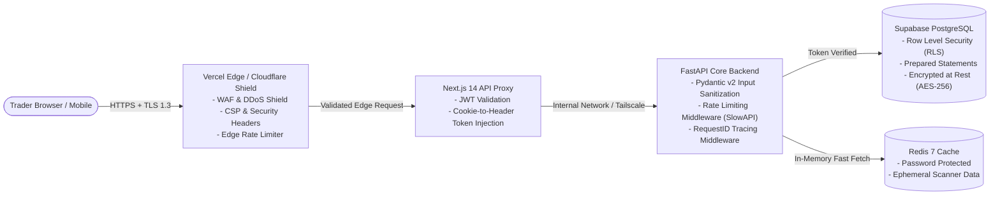

# TRADESCOUT — Security Architecture & Scale Strategy

> **Target SLA:** 99.9% Uptime  
> **Latency Budget:** API < 15ms (Redis Cache Hit), On-Demand Parquet Slice < 200ms  
> **Security Baseline:** OWASP Top 10 Compliant, SEBI Regulatory Safe

---

## 1. Security Architecture & Threat Mitigation

TRADESCOUT is an informational market analytics and scanning platform. It explicitly avoids executing trades, holding customer funds, or managing broker access tokens. This zero-custody footprint significantly minimizes attack surface while prioritizing user data confidentiality and API availability.



---

## 2. Authentication, Authorization & Identity Management

### 2.1 JWT Verification Flow Across Distributed Tiers

1. **Client-Side Auth:**
   - Authenticated through Supabase Auth using PKCE (Proof Key for Code Exchange) flow.
   - JWT tokens stored in `httpOnly`, `SameSite=Lax`, `Secure` cookies to prevent XSS exfiltration.
2. **Edge Middleware (Next.js):**
   - Reads session token from cookie, checks validity with Supabase Auth, and appends `x-user-id` and `x-user-role` headers to downstream backend proxies.
3. **Backend Service Verification (FastAPI):**
   - FastAPI decodes the Supabase JWT using the shared `SUPABASE_JWT_SECRET` via `python-jose` or PyJWT with `HS256` verification.
   - Validates claims: `aud == "authenticated"`, `exp > now()`, and extracts `sub` (User UUID).

```python
# Sample FastAPI JWT Dependency (api/app/core/security.py)
from fastapi import Depends, HTTPException, status
from fastapi.security import HTTPBearer, HTTPAuthorizationCredentials
import jwt
from pydantic import BaseModel
from app.core.config import settings

security = HTTPBearer(auto_error=False)

class AuthenticatedUser(BaseModel):
    user_id: str
    email: str
    plan: str = "free"

async def get_current_user(
    creds: HTTPAuthorizationCredentials = Depends(security)
) -> AuthenticatedUser:
    if not creds:
        raise HTTPException(
            status_code=status.HTTP_401_UNAUTHORIZED,
            detail="Authentication token required"
        )
    try:
        payload = jwt.decode(
            creds.credentials,
            settings.SUPABASE_JWT_SECRET,
            algorithms=["HS256"],
            audience="authenticated"
        )
        return AuthenticatedUser(
            user_id=payload.get("sub"),
            email=payload.get("email"),
            plan=payload.get("user_metadata", {}).get("plan", "free")
        )
    except jwt.PyJWTError:
        raise HTTPException(
            status_code=status.HTTP_401_UNAUTHORIZED,
            detail="Invalid or expired authentication credentials"
        )
```

---

## 3. Defense-in-Depth Security Controls

### 3.1 Content Security Policy (CSP) & HTTP Security Headers

Next.js `next.config.js` enforces strict HTTP headers across all client responses:

```javascript
// web/next.config.js security headers
const securityHeaders = [
  { key: 'X-DNS-Prefetch-Control', value: 'on' },
  { key: 'Strict-Transport-Security', value: 'max-age=63072000; includeSubDomains; preload' },
  { key: 'X-XSS-Protection', value: '1; mode=block' },
  { key: 'X-Frame-Options', value: 'DENY' },
  { key: 'X-Content-Type-Options', value: 'nosniff' },
  { key: 'Referrer-Policy', value: 'strict-origin-when-cross-origin' },
  {
    key: 'Content-Security-Policy',
    value: `
      default-src 'self';
      script-src 'self' 'unsafe-eval' 'unsafe-inline' https://cdn.jsdelivr.net;
      style-src 'self' 'unsafe-inline' https://fonts.googleapis.com;
      font-src 'self' https://fonts.gstatic.com;
      img-src 'self' data: https: blob:;
      connect-src 'self' https://*.supabase.co wss://*.supabase.co https://api.tradescout.in;
      frame-ancestors 'none';
    `.replace(/\s{2,}/g, ' ').trim()
  }
];
```

### 3.2 Rate Limiting Policies

Configured via SlowAPI and Redis token-bucket counters:

| Endpoint Category | Anonymous Tier | Free Registered Tier | Pro Member Tier |
| :--- | :--- | :--- | :--- |
| **Scanner Endpoints** (`/api/scanners/*`) | 30 requests / min | 120 requests / min | 600 requests / min |
| **Stock Chart Historical** (`/api/stock/*`) | 60 requests / min | 180 requests / min | 1,000 requests / min |
| **Auth & Password Recovery** | 5 requests / min | 5 requests / min | 5 requests / min |
| **Custom Scan Execution** (`/api/scan`) | Blocked | 5 requests / min | 60 requests / min |

---

## 4. Horizontal Scalability & Performance Strategy

### 4.1 Throughput & Latency Architecture

TRADESCOUT's zero-scraper, pre-computed paradigm enables remarkable horizontal scalability with minimal compute costs.

```
                    +--------------------------------+
                    | Vercel Edge Network (Mumbai)   |
                    | 99% Cached Static & ISR Pages  |
                    +---------------+----------------+
                                    |
                    +---------------+----------------+
                    | FastAPI Backend Cluster        |
                    | (Stateless Docker Replicas)    |
                    +---------------+----------------+
                                    |
              +---------------------+---------------------+
              |                                           |
+-------------v--------------+             +--------------v---------------+
| Redis 7 In-Memory Store     |             | Read-Only Parquet Store      |
| Pre-computed Scanner JSONs |             | Hugging Face CDN (Direct)    |
| P99 Latency: < 4ms         |             | Per-Symbol Deep History      |
+----------------------------+             +------------------------------+
```

1. **Zero Dynamic Database Reads for Scanners:**
   Because market scanning data is daily settlement data (EOD), scanner tables do not query PostgreSQL. They read static, pre-computed JSON snapshots directly from Redis RAM or local memory.
2. **Stateless Compute Workers:**
   The FastAPI container holds zero local state. Any instance can service any request. Additional instances can be spawned via Hetzner Cloud or Docker Swarm in $< 10$ seconds.
3. **Database Connection Pooling:**
   User watchlist queries connect to Supabase through built-in Supavisor / PgBouncer transaction pooling, supporting up to 10,000 concurrent client sessions on modest PostgreSQL instances.

---

## 5. SEBI Regulatory Compliance & Data Safety

To maintain absolute legal compliance with Indian Securities and Exchange Board of India (SEBI) guidelines:

1. **Mandatory Disclaimer Banner:**
   Prominently rendered in application footer and on individual stock analytical sheets:
   > *"TRADESCOUT is an educational and analytical tool designed for market research. We are NOT a SEBI-registered Research Analyst or Investment Advisor. All scanner results, technical ratings, and chart patterns are generated purely through mathematical algorithms and do NOT constitute buy, sell, or hold investment recommendations. Trading in equities, derivatives, and securities involves substantial risk of capital loss."*
2. **Zero Tipsters & Recommendations:**
   System labels avoid directive terminology such as `"BUY NOW"` or `"TARGET PRICE"`. Instead, neutral technical descriptors are enforced: `"Conditions Met"`, `"Stage 2 Markup"`, `"Volume Expansion"`.
3. **Zero Broker Integration:**
   TRADESCOUT does not request or store broker API secrets (Zerodha Kite, Groww, AngelOne). All trade execution is kept strictly external.
