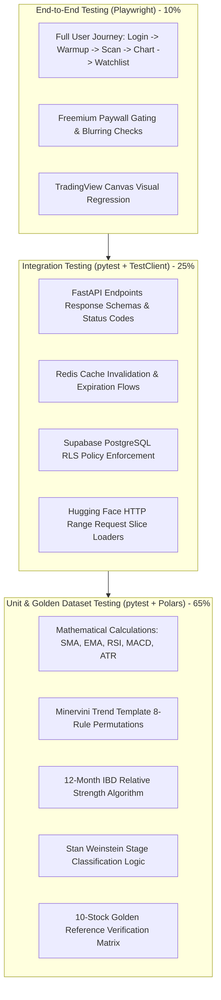

# TRADESCOUT — Comprehensive Testing Strategy & Quality Assurance

> **Standard:** Zero Tolerance for Calculation Drift in Financial Calculations  
> **Target Coverage:** $\ge 85\%$ Unit Coverage, 100% Golden Set Verification  
> **Frameworks:** pytest (Async), pytest-mock, Playwright, Lighthouse CI

---

## 1. Testing Pyramid & Verification Topology



---

## 2. Unit Testing & Golden Dataset Regression Engine

Financial market screeners cannot tolerate calculation drift. An error in an indicator formula results in false breakout signals and loss of user capital. TRADESCOUT mandates a strict **Golden Dataset Benchmark**.

### 2.1 The 10-Stock Golden Reference Set

Tests compare computed values against pre-verified reference numbers across 10 diverse market leaders:

| Symbol | Benchmark Scenario | Primary Indicator Verified |
| :--- | :--- | :--- |
| `RELIANCE` | High liquidity mega-cap benchmark | 200 SMA slope, 50 SMA alignment |
| `TCS` | Low-beta IT sector heavyweight | 14-day Wilder RSI calculation |
| `HDFCBANK` | Heavy banking weight, index anchor | RS Rating relative to NIFTY 50 |
| `INFY` | Gap-down earnings behavior test | True Range & ATR calculation |
| `ITC` | Multi-month base accumulation | Stage 1 to Stage 2 transition |
| `ICICIBANK` | Sustained Stage 2 markup leader | Minervini Trend Template pass status |
| `HINDUNILVR` | FMCG consolidation & base test | RVOL and 50-day average volume |
| `SBIN` | PSU Banking high momentum | 52-week High proximity formula |
| `BHARTIARTL` | Consistent multi-year uptrend | RS Rating score percentile stability |
| `LT` | Infrastructure cyclical breakout | Volume expansion on 4% breakout |

### 2.2 Pytest Golden Verification Implementation

```python
# tests/unit/test_golden_indicators.py
import pytest
import polars as pl
import numpy as np
from app.services.indicators import compute_all_market_indicators

GOLDEN_TOLERANCE = 0.0001  # 0.01% maximum variance

@pytest.fixture
def sample_eod_data() -> pl.DataFrame:
    """Loads 252-day historical slice for benchmark symbols."""
    return pl.read_parquet("tests/fixtures/golden_stocks_252d.parquet")

@pytest.fixture
def sample_delivery_data() -> pl.DataFrame:
    return pl.read_parquet("tests/fixtures/golden_delivery_252d.parquet")

def test_minervini_trend_template_accuracy(sample_eod_data, sample_delivery_data):
    df_calc = compute_all_market_indicators(sample_eod_data, sample_delivery_data)
    
    # Verify RELIANCE Minervini conditions
    reliance = df_calc.filter((pl.col("symbol") == "RELIANCE") & (pl.col("date") == "2026-11-11")).to_dicts()[0]
    
    assert reliance["sma_50"] > reliance["sma_150"], "50 SMA must be greater than 150 SMA"
    assert reliance["sma_150"] > reliance["sma_200"], "150 SMA must be greater than 200 SMA"
    assert reliance["from_52w_high"] >= -25.0, "Must be within 25% of 52W high"
    assert reliance["from_52w_low"] >= 30.0, "Must be at least 30% above 52W low"

def test_rsi_wilder_calculation_precision(sample_eod_data, sample_delivery_data):
    df_calc = compute_all_market_indicators(sample_eod_data, sample_delivery_data)
    tcs = df_calc.filter((pl.col("symbol") == "TCS") & (pl.col("date") == "2026-11-11")).to_dicts()[0]
    
    # Expected pre-verified RSI value from authoritative source
    EXPECTED_TCS_RSI = 58.42
    assert np.isclose(tcs["rsi"], EXPECTED_TCS_RSI, atol=0.1), f"TCS RSI expected {EXPECTED_TCS_RSI}, got {tcs['rsi']}"
```

---

## 3. Integration Testing & API Contracts

Integration tests ensure contract stability between the FastAPI backend and Next.js frontend using `httpx.AsyncClient`.

```python
# tests/integration/test_scanners_api.py
import pytest
from httpx import AsyncClient
from app.main import app

@pytest.mark.asyncio
async def test_public_scanner_returns_top_10_for_guests():
    async with AsyncClient(app=app, base_url="http://test") as client:
        response = await client.get("/api/scanners/trend-template")
        assert response.status_code == 200
        data = response.json()
        
        assert "data" in data
        assert "metadata" in data
        assert len(data["data"]) == 10, "Guest response must be restricted to 10 stocks"
        assert data["metadata"]["total_matches"] > 10
        assert data["metadata"]["is_truncated"] is True

@pytest.mark.asyncio
async def test_pro_user_receives_full_scanner_results(pro_auth_headers):
    async with AsyncClient(app=app, base_url="http://test") as client:
        response = await client.get("/api/scanners/trend-template", headers=pro_auth_headers)
        assert response.status_code == 200
        data = response.json()
        
        assert len(data["data"]) > 10, "Pro subscriber must receive all qualifying symbols"
        assert data["metadata"]["is_truncated"] is False
```

---

## 4. End-to-End (E2E) Browser Testing with Playwright

Playwright automates multi-step user workflows on Chromium, Firefox, and WebKit rendering engines:

```typescript
// web/tests/e2e/scanner_to_chart_flow.spec.ts
import { test, expect } from '@playwright/test';

test.describe('Trader Journey: Scanner to Chart Execution', () => {
  test('User can filter Trend Template and navigate to Stock Chart', async ({ page }) => {
    // 1. Visit Warmup cockpit
    await page.goto('/warmup');
    await expect(page.locator('h1')).toContainText('Market Read');

    // 2. Click through to Scanners
    await page.click('text=Trend Template');
    await expect(page).toHaveURL(/\/scanners\/trend-template/);

    // 3. Verify Table Render
    const table = page.locator('table');
    await expect(table).toBeVisible();
    await expect(table.locator('tbody tr')).toHaveCount(10); // Free tier default

    // 4. Click first stock symbol
    const firstStockSymbol = await page.locator('tbody tr:first-child td a').first().textContent();
    await page.locator('tbody tr:first-child td a').first().click();

    // 5. Verify Stock Detail & Canvas
    await expect(page).toHaveURL(new RegExp(`/stock/${firstStockSymbol?.trim()}`));
    await expect(page.locator('canvas')).toBeVisible(); // TradingView canvas loaded
    await expect(page.locator('text=Relative Strength')).toBeVisible();
  });
});
```

---

## 5. Performance, Load & Continuous Quality Gates

1. **Lighthouse CI Audits:**
   - Run on every preview deployment to prevent regressions in Core Web Vitals.
   - Budgets: Largest Contentful Paint (LCP) $< 1.8\text{s}$, Cumulative Layout Shift (CLS) $< 0.05$.
2. **Stress Testing (Locust):**
   - Simulated traffic: 500 concurrent virtual traders querying `/api/scanners/*` and `/api/stock/*`.
   - SLA threshold: Error rate $0.00\%$, 95th percentile latency $< 50\text{ms}$.
3. **Automated CI/CD Workflow (GitHub Actions):**
   - **Lint Step:** `ruff check .` and `tsc --noEmit`.
   - **Test Step:** `pytest --cov=app --cov-report=xml`.
   - **Security Step:** `bandit -r api/` and `npm audit`.
   - **Golden Step:** `pytest tests/unit/test_golden_indicators.py`.
