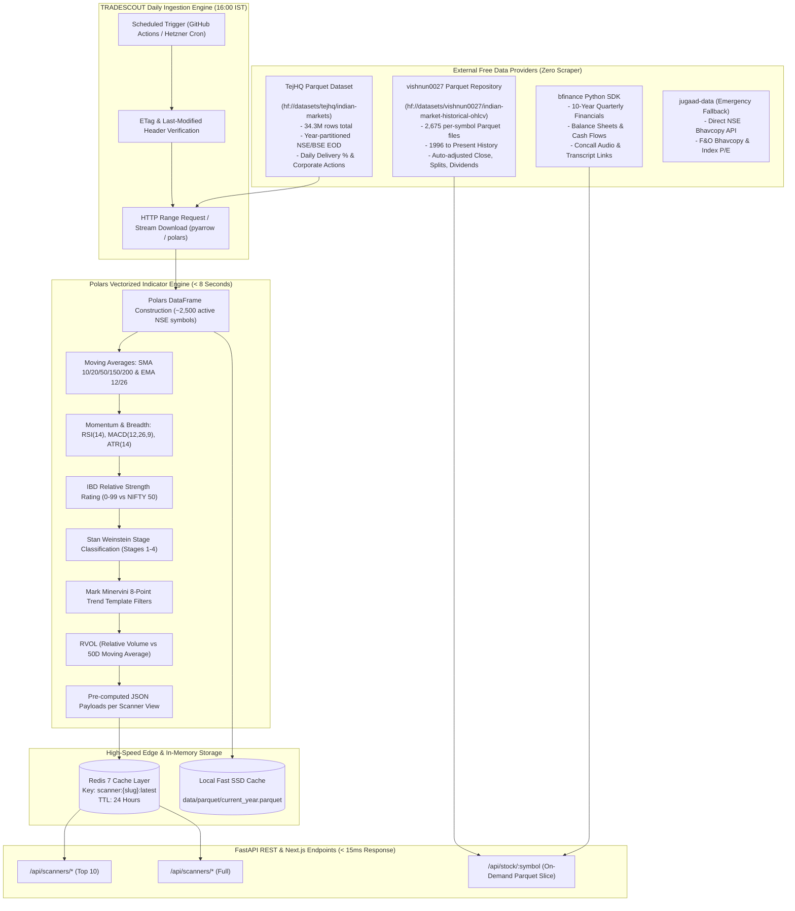

# TRADESCOUT — Zero-Scraper Data Pipeline Specification

> **Version:** 1.0.0  
> **Status:** Architecture Finalized  
> **Core Principle:** Zero Web Scraping. 100% Free, Distributed, Cloud-Native Parquet Ingestion over HTTP.

---

## 1. Pipeline Architectural Overview

Traditional stock screening architectures rely on fragile HTML/CSV scrapers interacting with exchange servers (e.g., `nseindia.com`). These scrapers consistently break due to IP rate limits, Cloudflare Akamai Bot Manager challenges, session cookie rotation, and random header changes.

**TRADESCOUT completely eliminates scrapers.** It consumes verified, clean, open-access, daily-updated Apache Parquet datasets hosted on Hugging Face. These datasets are queried directly over HTTP using Polars lazy frames and DuckDB without requiring API keys, headless browsers, or residential proxies.



---

## 2. In-Depth Dataset Schema Specifications

### 2.1 Primary Dataset: `tejhq/indian-markets`

The core workhorse for full-market scans across all ~2,500 traded equities.

- **Hosting Location:** Hugging Face Datasets (`tejhq/indian-markets`)
- **Format:** Apache Parquet with Snappy Compression
- **Storage Layout:** Partitioned by Year and Exchange
  - `nse/year=2026/nse_2026.parquet`
  - `delivery/year=2026/delivery_2026.parquet`
  - `corporate_actions/actions.parquet`
  - `universe/symbols.parquet`
- **Volume:** ~580,000 rows per calendar year for NSE equity series `EQ`.

#### Verified Schema Table (`nse_2026.parquet`):

| Column Name | Polars Data Type | Sample Value | Description |
| :--- | :--- | :--- | :--- |
| `date` | `pl.Date` | `2026-11-11` | Trading session date |
| `symbol` | `pl.Utf8` | `"RELIANCE"` | NSE trading ticker symbol |
| `series` | `pl.Utf8` | `"EQ"` | Market segment (`EQ`, `BE`, `SM`) |
| `isin` | `pl.Utf8` | `"INE002A01018"` | International Securities ID |
| `name` | `pl.Utf8` | `"Reliance Industries Limited"` | Full legal corporate name |
| `open` | `pl.Float64` | `1255.00` | Session opening auction price |
| `high` | `pl.Float64` | `1280.40` | Intraday recorded high |
| `low` | `pl.Float64` | `1251.10` | Intraday recorded low |
| `close` | `pl.Float64` | `1274.50` | Official EOD settlement close price |
| `last` | `pl.Float64` | `1275.00` | Last traded price (LTP) at 15:30 IST |
| `prev_close` | `pl.Float64` | `1251.35` | Previous trading session close |
| `volume` | `pl.Int64` | `8420194` | Total executed share quantity |
| `turnover` | `pl.Float64` | `10735749250.0`| Total monetary turnover (₹) |
| `trades` | `pl.Int64` | `245192` | Total number of individual trade tickets |
| `year` | `pl.Int32` | `2026` | Partition year |
| `month` | `pl.Int32` | `11` | Calendar month index |

#### Verified Delivery Schema Table (`delivery_2026.parquet`):

| Column Name | Polars Data Type | Sample Value | Description |
| :--- | :--- | :--- | :--- |
| `date` | `pl.Date` | `2026-11-11` | Trading session date |
| `symbol` | `pl.Utf8` | `"RELIANCE"` | NSE trading ticker symbol |
| `traded_quantity` | `pl.Int64` | `8420194` | Total volume traded |
| `delivery_quantity`| `pl.Int64` | `4850201` | Quantity marked for actual demat delivery |
| `delivery_pct` | `pl.Float64` | `57.60` | Delivery Percentage (`delivery_qty / traded_qty * 100`) |

---

### 2.2 Secondary Dataset: `vishnun0027/indian-market-historical-ohlcv`

Used for on-demand deep historical charts (1996–present) when rendering the TradingView interface.

- **Hosting Location:** `hf://datasets/vishnun0027/indian-market-historical-ohlcv`
- **File Structure:** Individual symbol Parquet files: `data/{symbol}.parquet` (e.g., `data/TRENT.parquet`)
- **Total Coverage:** 2,675 individual equities and indices
- **Performance:** Direct HTTP Range reads stream 7,700+ rows in ~1.1 seconds.
- **Columns:** `[date, open, high, low, close, adj_close, volume, dividends, stock_splits, symbol]`

---

## 3. Polars Vectorized Indicator Engine Implementation

Rather than using sequential row iteration or Pandas loops, TRADESCOUT utilizes Polars expressions. Polars compiles parallel Rust execution plans across multi-core CPU threads, evaluating all technical criteria for 2,500 symbols in under 8 seconds.

### 3.1 Python Ingestion & Calculation Script

```python
"""
TRADESCOUT Core Indicator Engine
Vectorized calculation of Minervini Trend Template, RS Ratings, Weinstein Stages.
"""
from datetime import date
from typing import Dict, Any
import polars as pl

def compute_all_market_indicators(df_raw: pl.DataFrame, df_delivery: pl.DataFrame) -> pl.DataFrame:
    """
    Ingests raw NSE EOD data and outputs fully calculated scanner fields.
    """
    # 1. Join Price and Delivery metrics
    df = df_raw.filter(pl.col("series") == "EQ").join(
        df_delivery.select(["date", "symbol", "delivery_pct"]),
        on=["date", "symbol"],
        how="left"
    )

    # 2. Sort temporally per symbol for window expressions
    df = df.sort(["symbol", "date"])

    # 3. Vectorized Window Moving Averages & Bands
    df = df.with_columns([
        pl.col("close").rolling_mean(window_size=10).over("symbol").alias("sma_10"),
        pl.col("close").rolling_mean(window_size=20).over("symbol").alias("sma_20"),
        pl.col("close").rolling_mean(window_size=50).over("symbol").alias("sma_50"),
        pl.col("close").rolling_mean(window_size=150).over("symbol").alias("sma_150"),
        pl.col("close").rolling_mean(window_size=200).over("symbol").alias("sma_200"),
        pl.col("volume").rolling_mean(window_size=50).over("symbol").alias("vol_sma_50"),
        pl.col("high").rolling_max(window_size=252).over("symbol").alias("high_52w"),
        pl.col("low").rolling_min(window_size=252).over("symbol").alias("low_52w"),
    ])

    # 4. Momentum, Proximity & Volume Ratios
    df = df.with_columns([
        # Relative Volume (RVOL)
        (pl.col("volume") / pl.when(pl.col("vol_sma_50") > 0).then(pl.col("vol_sma_50")).otherwise(1.0)).alias("rvol"),
        # Distance from 52-week High/Low
        (((pl.col("close") - pl.col("high_52w")) / pl.col("high_52w")) * 100.0).alias("from_52w_high"),
        (((pl.col("close") - pl.col("low_52w")) / pl.col("low_52w")) * 100.0).alias("from_52w_low"),
        # Percentage Change
        (((pl.col("close") - pl.col("prev_close")) / pl.col("prev_close")) * 100.0).alias("change_pct"),
    ])

    # 5. Mark Minervini Trend Template (8 Mandatory Criteria)
    trend_template_expr = (
        (pl.col("close") > pl.col("sma_150")) &
        (pl.col("close") > pl.col("sma_200")) &
        (pl.col("sma_150") > pl.col("sma_200")) &
        (pl.col("sma_200") > pl.col("sma_200").shift(20).over("symbol")) &  # 200 SMA trending up for 1 month
        (pl.col("sma_50") > pl.col("sma_150")) &
        (pl.col("sma_50") > pl.col("sma_200")) &
        (pl.col("close") > pl.col("sma_50")) &
        (pl.col("close") >= (pl.col("low_52w") * 1.30)) &                    # At least 30% above 52w low
        (pl.col("close") >= (pl.col("high_52w") * 075))                     # Within 25% of 52w high
    )

    df = df.with_columns([
        trend_template_expr.alias("minervini_pass")
    ])

    # 6. Stan Weinstein Stage Analysis Classification
    # Stage 1: Base (close near 200 SMA, 200 SMA flat)
    # Stage 2: Markup (close > 50 SMA > 200 SMA, 200 SMA rising)
    # Stage 3: Distribution (close fluctuating around topping 200 SMA)
    # Stage 4: Markdown (close < 50 SMA < 200 SMA, 200 SMA declining)
    df = df.with_columns([
        pl.when(
            (pl.col("close") > pl.col("sma_50")) &
            (pl.col("sma_50") > pl.col("sma_200")) &
            (pl.col("close") > pl.col("sma_200"))
        ).then(pl.lit(2))
        .when(
            (pl.col("close") < pl.col("sma_50")) &
            (pl.col("sma_50") < pl.col("sma_200"))
        ).then(pl.lit(4))
        .when(
            (pl.col("close") > pl.col("sma_200")) &
            (pl.col("sma_50") <= pl.col("sma_200"))
        ).then(pl.lit(1))
        .otherwise(pl.lit(3))
        .alias("stage")
    ])

    df = df.with_columns([
        pl.col("stage").map_elements(
            lambda s: {1: "Stage 1 (Base)", 2: "Stage 2 (Markup)", 3: "Stage 3 (Top)", 4: "Stage 4 (Decline)"}.get(s, "Neutral"),
            return_dtype=pl.Utf8
        ).alias("stage_name")
    ])

    return df
```

### 3.2 IBD-Style 12-Month Relative Strength (RS) Rating Algorithm

The RS Rating scales from 1 (worst) to 99 (best), weighted across 4 rolling quarters with double weighting on the most recent 3 months:

$$\text{Raw RS} = 0.40 \times \left(\frac{C_0 - C_{63}}{C_{63}}\right) + 0.20 \times \left(\frac{C_{63} - C_{126}}{C_{126}}\right) + 0.20 \times \left(\frac{C_{126} - C_{189}}{C_{189}}\right) + 0.20 \times \left(\frac{C_{189} - C_{252}}{C_{252}}\right)$$

Where $C_0$ is the current close, $C_{63}$ is the close 63 trading sessions ago (~3 months), etc.  
Once Raw RS is computed across all 2,500 symbols, it is mapped to a percentile rank between `1` and `99`.

---

## 4. Automation & Daily Refresh Lifecycle

The pipeline operates completely autonomously via a lightweight orchestrator:

```
[Time: 15:30 IST]  -> NSE Market Closes
[Time: 15:45 IST]  -> NSE Publishes Final Settlement Bhavcopy
[Time: 16:00 IST]  -> Hugging Face Sync Process commits updated nse_2026.parquet
[Time: 16:15 IST]  -> TRADESCOUT Pipeline Trigger (GitHub Actions / Hetzner Cron)
                       - Downloads latest Parquet delta
                       - Runs Polars Indicator Engine
                       - Generates 7 Pre-computed Scanner JSON files
                       - Uploads JSON payloads directly into Redis 7
                       - Updates /api/metadata "last_synced" timestamp
[Time: 16:16 IST]  -> Zero-Downtime Cache Swap Complete.
```

### 4.1 Redis Caching Key Architecture

| Cache Key Pattern | Data Payload | Compression | TTL | Invalidation Condition |
| :--- | :--- | :--- | :--- | :--- |
| `scanner:trend-template:latest` | Array of stocks passing 8 Minervini rules | Gzip JSON | 24 Hours | Overwritten at 16:15 IST |
| `scanner:recent-breakout:latest` | Stocks with >4% gain and RVOL > 2.0x | Gzip JSON | 24 Hours | Overwritten at 16:15 IST |
| `scanner:vcp:latest` | Stocks with tightening volatility bands | Gzip JSON | 24 Hours | Overwritten at 16:15 IST |
| `market:breadth:latest` | Advance/Decline, 52W High/Low counts | Plain JSON | 24 Hours | Overwritten at 16:15 IST |
| `stock:summary:{symbol}` | Mini technical summary & latest indicators | Plain JSON | 24 Hours | Overwritten at 16:15 IST |

---

## 5. Failover, Resiliency & Verification Harness

1. **Stale Parquet Detection:**
   Before running calculations, the ingestor checks if `max(date)` in the Parquet matches today's date. If today is an NSE trading holiday, the pipeline gracefully sleeps without invalidating existing cache.
2. **Emergency Fallback (`jugaad-data`):**
   If Hugging Face experiences an outage or sync delay past 17:30 IST, an automated fallback invokes `jugaad-data` to directly pull the raw zip Bhavcopy from `https://archives.nseindia.com/content/historical/EQUITIES/` and converts it into temporary Polars tables.
3. **Automated Anomaly Thresholds:**
   - If total scanned symbols $< 2,000$ (expected $\approx 2,500$), an immediate warning is dispatched to Sentry.
   - If Nifty 50 close deviates $> 10\%$ in a single session without circuit breaker event, calculation halts and flags pipeline for human review.
