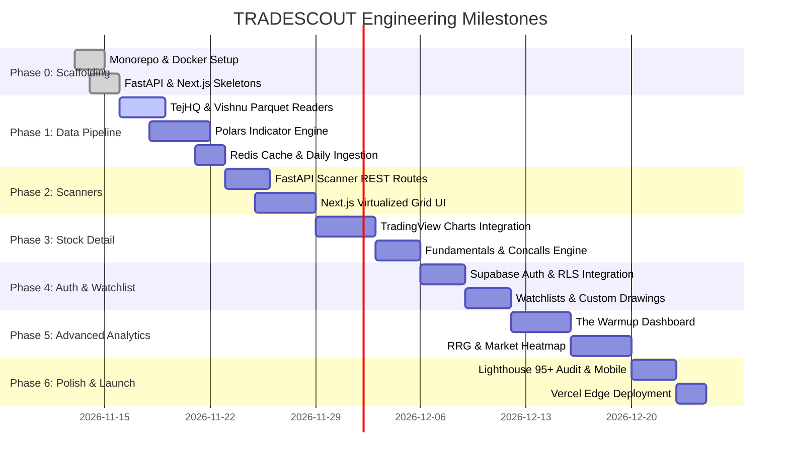

# TRADESCOUT — Phased Implementation & Engineering Roadmap

> **Target Release Window:** Q4 2026 / Q1 2027  
> **Repository Architecture:** Monorepo (`api/`, `web/`, `infra/`, `tests/`, `docs/`)  
> **Development Lead:** Vansh Panchal

---

## 1. Roadmap Overview & Timeline Gantt



---

## 2. Granular Phase Breakdown

### Phase 0: Monorepo Scaffolding & Core Infrastructure (Days 1–3)
- [ ] **Task 0.1: Repository Structure Setup**
  - Establish monorepo tree:
    ```
    TRADESCOUT/
    ├── api/          # FastAPI Python 3.12+ backend
    ├── web/          # Next.js 14 App Router frontend
    ├── infra/        # Docker Compose, Traefik/Nginx configs
    ├── tests/        # Global E2E and golden dataset suites
    └── docs/         # Architecture and API specs
    ```
- [ ] **Task 0.2: Local Development Docker Environment**
  - Configure `infra/docker-compose.yml` with PostgreSQL 16, Redis 7 (AOF enabled), and pgAdmin.
  - Verify container healthchecks (`pg_isready` and `redis-cli ping`).
- [ ] **Task 0.3: Backend Skeleton (`api/`)**
  - Initialize FastAPI application with async lifespans.
  - Implement standard `/healthz` and `/readyz` probes.
  - Implement `RequestIDMiddleware` and structured JSON logger via `structlog`.
- [ ] **Task 0.4: Frontend Skeleton (`web/`)**
  - Initialize Next.js 14 App Router with TypeScript, Tailwind CSS, Radix UI primitives.
  - Configure Hanken Grotesk Google Font integration.
  - Establish dark mode theme provider with CSS class persistence (`stc-theme`).

---

### Phase 1: Zero-Scraper Data Pipeline & Polars Indicator Engine (Days 4–9)
- [ ] **Task 1.1: Hugging Face Parquet Stream Connector**
  - Implement asynchronous Parquet slice fetcher from `hf://datasets/tejhq/indian-markets`.
  - Implement fallback loader using `jugaad-data`.
- [ ] **Task 1.2: High-Performance Polars Computation Engine**
  - Vectorized calculation of Moving Averages: SMA (10, 20, 50, 150, 200) and EMA (12, 26).
  - Vectorized 14-period RSI using Wilder's exponential smoothing.
  - 12-Month Relative Strength (RS) Rating percentile algorithm (IBD-style vs Nifty 50).
  - Stan Weinstein Stage Analysis classifier (Stages 1, 2, 3, 4).
  - Mark Minervini 8-point Trend Template validation filter.
  - Relative Volume (RVOL) calculation against 50-day average.
- [ ] **Task 1.3: Golden Data Unit Test Suite**
  - Validate indicator accuracy against a benchmark golden dataset of 10 major NSE symbols (`RELIANCE`, `TCS`, `HDFCBANK`, `INFY`, `ITC`, `ICICIBANK`, `HINDUNILVR`, `SBIN`, `BHARTIARTL`, `LT`). Tolerance: $\pm 0.01\%$.
- [ ] **Task 1.4: Pre-Computed Redis Caching Service**
  - Generate serialized JSON blobs for all default scanners post-market (16:15 IST).
  - Write payloads to Redis with 24-hour TTL and automated expiration hooks.

---

### Phase 2: High-Speed Scanner API & Data Grid UI (Days 10–14)
- [ ] **Task 2.1: FastAPI Scanner Endpoints**
  - Implement `/api/scanners/{slug}` endpoints with query parameters (`limit`, `offset`, `sort_by`, `direction`).
  - Implement `/api/metadata` providing market status and data sync timestamps.
  - Implement Next.js catch-all API proxy (`web/src/app/api/[...path]/route.ts`).
- [ ] **Task 2.2: Next.js High-Performance Scanner Grid**
  - Build responsive TanStack Table v8 data grid with virtualized DOM scrolling.
  - Sticky header and freeze columns for ticker symbol and CMP.
  - Inline canvas sparklines displaying 20-day price trend.
  - Instant client-side text filtering and multi-column sorting.
- [ ] **Task 2.3: Freemium Blur & Paywall Shield**
  - Render top 10 items freely; dynamically blur subsequent rows for unauthenticated guests.
  - Modal CTA dialog for free registration and Pro upgrade.

---

### Phase 3: Stock Detail & TradingView Charting Engine (Days 15–20)
- [ ] **Task 3.1: Historical Parquet Ingestion**
  - Implement per-symbol loader from `vishnun0027/indian-market-historical-ohlcv` over HTTP.
  - Expose `/api/stock/{symbol}` and `/api/stock/{symbol}/rs_line`.
- [ ] **Task 3.2: TradingView Lightweight Charts v4 Integration**
  - Embed HTML5 Canvas candlestick series with custom color styling (bullish cyan `#00E5FF`, bearish slate `#64748B`).
  - Overlay line series: 10, 20, 50, and 200 SMAs with toggle controls.
  - Volume histogram sub-pane with color-coded volume spikes ($> 2.0\times$ 50D average).
  - Relative Strength line sub-pane comparing stock performance against NIFTY 50.
  - Breakout pivot line dashed overlays and tight area consolidation boxes.
- [ ] **Task 3.3: Fundamentals & Concalls Engine**
  - Connect `bfinance` SDK to retrieve 10-year quarterly financial statements.
  - Render YoY Sales Growth, EBITDA Margin %, ROCE %, and Shareholding patterns.
  - Display transcript links for quarterly earnings conference calls.

---

### Phase 4: Supabase Authentication, RLS & Watchlists (Days 21–25)
- [ ] **Task 4.1: Supabase Auth & Session Management**
  - Implement Magic Link, Email/Password, and Google OAuth via Supabase SSR client.
  - Middleware JWT verification on both Next.js Edge and FastAPI backend.
- [ ] **Task 4.2: Watchlist Engine**
  - CRUD operations for user watchlists backed by PostgreSQL RLS.
  - Free tier guard: Maximum 1 list, 20 items. Pro tier: Unlimited.
  - Quick-add shortcut (`W` key) from any scanner table row.
- [ ] **Task 4.3: Cloud Drawing & Note Persistence**
  - Store serialized TradingView canvas drawing shapes in `chart_drawings` table.
  - Auto-saving private notes journal in `stock_notes` table.

---

### Phase 5: Warmup Dashboard, RRG & Heatmap (Days 26–30)
- [ ] **Task 5.1: The Warmup Market Read Screen**
  - Market participation radial gauge (% of NSE 500 above 50 SMA).
  - RME Sentiment diagnostic index.
  - Weinstein Stage 2 vs Stage 4 distribution ratio bar.
  - Daily pre-market cues feed and upcoming earnings horizon.
- [ ] **Task 5.2: Relative Rotation Graph (`/rrg`)**
  - Vectorized calculation of JdK RS-Ratio and RS-Momentum.
  - Interactive 2D scatter canvas showing Leading, Weakening, Lagging, Improving quadrants with trailing tails.
- [ ] **Task 5.3: Market Heatmap (`/heatmap`)**
  - Treemap visualization sized by Market Cap and colored by day percentage change.
  - Drill-down capability from Sectors to individual companies.

---

### Phase 6: Production Hardening, Testing & Vercel Launch (Days 31–35)
- [ ] **Task 6.1: End-to-End Test Suite**
  - Playwright browser test covering: Registration -> Warmup -> Scanner -> Stock Detail -> Add Watchlist -> Logout.
- [ ] **Task 6.2: Performance & Accessibility Audit**
  - Achieve Lighthouse Score $\ge 95$ across Performance, Accessibility, and Best Practices.
  - Code splitting and dynamic imports for TradingView canvas components.
- [ ] **Task 6.3: Deployment Pipeline**
  - Frontend: Automated deployment on Vercel with Edge middleware (Mumbai PoP).
  - Backend: Dockerized deployment on Hetzner Cloud or Railway.
  - Sentry monitoring configured across Next.js and FastAPI.
  - Configure custom production domain (e.g., `tradescout.in`).
