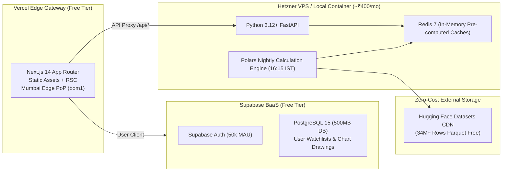

# 💰 TRADESCOUT: Cost, Resources & Infrastructure Feasibility Breakdown

> **Project:** TRADESCOUT (Indian Equity Swing Trading Screener)  
> **Source Investigation:** Extracted from the architecture consultation in the original reverse-engineering session.  
> **Target Budget:** **₹0 to ₹500/month ($0 - $6 USD)** during MVP / Phase 1–3, scaling to **< ₹2,500/month (< $30 USD)** at 50,000+ monthly active traders.

---

## 1. Cost Comparison: Traditional Screener vs. TRADESCOUT Zero-Scraper Architecture

Traditional fintech screeners run massive cloud relational databases (AWS RDS PostgreSQL), expensive server clusters with 32GB+ RAM to index tick data, and paid financial data API subscriptions (Refinitiv, Bloomberg, TrueData @ ₹25,000+/month).

ScanTheCharts proved that by operating as an **Aggregation & Mathematical Pre-computation Engine**, infrastructure costs can be crushed to near-zero.

| Cost Category | Traditional Fintech Architecture | ScanTheCharts / TRADESCOUT Architecture | Monthly Cost (MVP) |
| :--- | :--- | :--- | :--- |
| **Market Data Feeds** | TrueData / GlobalDataFeeds API (₹15,000–₹35,000/mo) | Open-Source EOD Parquet (Hugging Face) + NSE Archives | **₹0 (Free)** |
| **Historical Data Database** | AWS RDS PostgreSQL 100GB+ (₹6,000–₹12,000/mo) | Zero-database HTTP Parquet streaming + Redis in-memory cache | **₹0 (Free Tier / Included in VPS)** |
| **Frontend CDN & Edge** | Custom AWS CloudFront / Akamai (₹3,000/mo) | Vercel Hobby / Pro with Edge PoP in Mumbai (`bom1`) | **₹0 (Free) / ₹1,650 ($20 Pro)** |
| **User Auth & Watchlists** | Auth0 / Custom Auth Server (₹2,500/mo) | Supabase Free Tier (50,000 MAU, PostgreSQL RLS) | **₹0 (Free)** |
| **Backend Compute & Scanners** | AWS EC2 / Fargate clusters (₹8,000/mo) | 1x Hetzner Cloud VPS (CPX11: 2 vCPU, 2GB RAM) or Docker local | **~₹400/mo (€4.35 / $4.70)** |
| **Scraper Proxies & Captcha** | BrightData / ScraperAPI (₹4,000/mo) | Eliminated (Zero scrapers used) | **₹0** |
| **TOTAL ESTIMATED MONTHLY COST** | **₹38,500 – ₹65,000 / month** | **TRADESCOUT Optimized Stack** | **₹0 to ~₹400 / month** |

---

## 2. Infrastructure Component Allocation & Free Tiers

### Component Breakdown:

1. **Frontend Hosting (Vercel)**:
   - **Cost:** Free tier (Hobby) during development; $20/month if commercial team features are needed.
   - **Why:** Automatic deployment, SSL certificates, global CDN, and an edge point-of-presence directly in Mumbai (`bom1`) ensures < 30ms latency for Indian traders.

2. **Database & Identity (Supabase)**:
   - **Cost:** Free Tier includes:
     - 500 MB database storage (sufficient for 100,000+ user watchlists and drawings since market data is not stored here).
     - 50,000 Monthly Active Users (MAU) on Supabase Auth.
     - Row Level Security (RLS) guaranteeing user watchlist privacy.

3. **Backend Compute & Calculation Engine (Hetzner Cloud VPS)**:
   - **Specification:** Hetzner CPX11 (2 AMD vCPUs, 2 GB RAM, 40 GB NVMe, 20 TB Traffic).
   - **Cost:** €4.35 / month (~₹400 INR).
   - **Role:** Runs the FastAPI web application, Redis cache, and scheduled Polars execution scripts.

4. **Market Data Storage (Hugging Face Hub)**:
   - **Cost:** ₹0 (Public Open Data).
   - **Storage:** Over 34 Million rows of historical Bhavcopy and daily delivery data hosted on high-bandwidth CDNs.

---

## 3. Resource Requirements for Development & Production

### Development Environment (Local Machine):
- **CPU:** Any modern 4-core processor (Intel Core i5/i7, AMD Ryzen 5/7, Apple Silicon M1+).
- **RAM:** Minimum 8 GB (16 GB recommended for running Docker containers and Next.js dev server concurrently).
- **Disk Space:** 5 GB free disk space (Docker images + local Parquet caches).
- **Required Tooling:**
  - Node.js 18.17+ or 20 LTS
  - Python 3.11 or 3.12
  - Docker Desktop (for local PostgreSQL 16 & Redis 7)

### Production Sizing (Scalability Thresholds):

| User Scale (Concurrent Traders) | Infrastructure Setup | Estimated Monthly Cost | Bottlenecks / Action Items |
| :--- | :--- | :--- | :--- |
| **0 – 1,000 Users** | 1x Hetzner CPX11 (2 vCPU, 2GB RAM) + Vercel Hobby + Supabase Free | **₹400 / month** | None. Pre-computed Redis caches serve 10,000+ req/sec effortlessly. |
| **1,000 – 10,000 Users** | 1x Hetzner CPX21 (3 vCPU, 4GB RAM) + Vercel Pro ($20) + Supabase Pro ($25) | **~₹4,200 / month** | Add Redis read replicas if concurrency exceeds 5,000 req/sec during market open (09:15 IST). |
| **10,000 – 100,000 Users** | 2x Hetzner CCX23 Dedicated vCPU + Managed Redis Cluster + Vercel Enterprise | **~₹18,000 / month** | Migrate intraday 5-min WebSocket feeds to dedicated broker socket gateway (Dhan/Fyers/Kite). |

---

## 4. Key Financial Takeaway

You do **not** need investor funding or expensive data licenses to launch TRADESCOUT. The architecture designed from ScanTheCharts reverse-engineering allows complete end-to-end development, testing, and initial public launch for **less than the cost of a single coffee per month (~₹400 INR)**.
