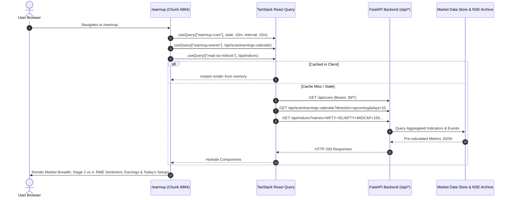

# 🏛️ Architecture & Tech Stack Teardown: ScanTheCharts.com

> **Target Analyzed**: `https://scanthecharts.com` & `https://scanthecharts.com/warmup`  
> **Brand & Creator**: Built under the **Swing Niveshak** brand by **Rahul** (Punjab, India)  
> **Target Market**: Indian Equities (**NSE** — ~3,037+ listed stocks)  
> **Investigation Methodology**: Reverse-engineering of Next.js Webpack bundles, FastAPI API contracts, Playwright headless execution, Supabase BaaS inspection, and network payload analysis.

---

## 1. Executive Summary & Architecture Topology

ScanTheCharts is a modern, high-performance financial market-data platform built specifically for Indian retail swing traders. It merges technical price action (Stan Weinstein Stage Analysis, Mark Minervini Trend Templates & VCP) with fundamental quarterly earnings metrics and corporate catalysts.

```mermaid
flowchart TD
    User([Trader / Web Client]) -->|HTTPS / Anycast| VercelEdge[Vercel CDN & Edge Gateway (bom1 - Mumbai)]
    
    subgraph Frontend ["Frontend Layer (Next.js 14+ App Router)"]
        Landing["Static Landing (/landing) - dc-runtime.js"]
        RSC["React Server Components Shell (self.__next_f)"]
        SPA["Client Router (/members SPA Shell)"]
        TVChart["TradingView Lightweight Charts v4 (HTML5 Canvas)"]
        TanStack["TanStack React Query Cache"]
        RadixUI["Radix UI Primitives + Tailwind CSS"]
    end

    subgraph BackendAPI ["API Gateway & Backend Layer"]
        NextProxy["Next.js Catch-All Proxy (/api/[...path])"]
        FastAPI["Python FastAPI Service (Pydantic v2 Validation)"]
    end

    subgraph DataStorage ["Data & Persistence Layer"]
        Supabase["Supabase (PostgreSQL + PostgREST)"]
        SupaAuth["Supabase Auth (JWT / Sessions)"]
        EODStore["Historical Market Data Store (3,037 Stocks / 950+ Bars)"]
        LiveFeed["5-Min Delayed Intraday Market Engine"]
        NSEArchives["NSE India Corporate Announcement PDF Archive"]
    end

    VercelEdge --> Landing
    VercelEdge --> RSC
    RSC --> SPA
    SPA --> TVChart
    SPA --> TanStack
    SPA --> RadixUI

    SPA -->|Authenticated REST| NextProxy
    NextProxy --> FastAPI
    FastAPI --> EODStore
    FastAPI --> LiveFeed
    FastAPI --> NSEArchives

    SPA -->|Client CRUD (Drawings, Watchlists)| Supabase
    SPA -->|Login / Signup / Password Reset| SupaAuth
```

---

## 2. Complete Technology Stack Matrix

| Layer | Technology | Evidence / Technical Identification |
| :--- | :--- | :--- |
| **Hosting & CDN** | **Vercel** (Global Anycast, Edge Node: `bom1` Mumbai) | Response Headers: `Server: Vercel`, `X-Vercel-Id: bom1::...`, CNAME `vercel-dns-017.com` |
| **Frontend Framework** | **Next.js 14+ (App Router)** + **React 18.3.1** | `X-Powered-By: Next.js`, RSC Flight Payloads (`self.__next_f`), dynamic chunk splitting |
| **Styling & Theme** | **Tailwind CSS** + **Dark Mode** | Chunk CSS `--tw-` variables, `localStorage` key `stc-theme="dark"` on `document.documentElement` |
| **Typography** | **Hanken Grotesk** (`__Hanken_Grotesk_fd3dff`) | Loaded via `next/font/google`, paired with tabular SFMono/ui-monospace for prices |
| **UI Component Primitives** | **Radix UI** (`@radix-ui/react-*`) | Found in `chunks_7158`: Popovers, Dialog modals, Dropdowns, Tooltips, Tabs |
| **Animations** | **Framer Motion** (`framer-motion`) | Found in layout transitions, modal enter/exits, and animated metric cards |
| **State & Data Fetching** | **TanStack Query (React Query)** | Query keys: `["warmup-cues"]`, `["stock", sym]`, `["rs-line"]`, `["financials"]` |
| **Charting Engine** | **TradingView Lightweight Charts v4** | `addCandlestickSeries`, `addLineSeries`, `addHistogramSeries`, `createChart`, `timeScale` |
| **Backend Framework** | **Python FastAPI** + **Pydantic v2** | Proven by 422 error schema: `{"detail":[{"type":"greater_than_equal","loc":["query","bars"]}]}` |
| **Database & Auth (BaaS)** | **Supabase** (`caeaenwgmwirobaqkdao.supabase.co`) | Anon Key: `sb_publishable_e1YfORff0AC4H9wCyAlZBA_K8t_K9NP`, PostgreSQL tables |
| **Error Telemetry** | **Sentry** (`@sentry/nextjs`) | `_sentryDebugIds` identifier tags, client error boundary reporting |
| **Market Data Universe** | **NSE India** (3,037 Stocks) | EOD bhavcopy ingestion + 5-minute delayed intraday feed (`delay_minutes: 5`) |

---

## 3. Deep Dive: How the `/warmup` ("The Market Read") Feature is Built

The `/warmup` route is marketed as *"The market read: A plain-English read on market health before the open."* It acts as a morning ritual dashboard for Indian swing traders to assess market health before the 9:15 AM IST bell.



### Component Breakdown of `/warmup`:

1. **Market Participation Gauges**:
   - Calculates the percentage of stocks trading above their **20-day, 50-day, and 200-day Simple Moving Averages**.
   - Computes market-wide breadth expansion vs contraction.
2. **Relative Momentum Engine (RME) Index**:
   - Classifies broader market momentum into one of five states:
     - `Washed out`
     - `Near washed out`
     - `Building`
     - `Near stretched`
     - `Stretched`
3. **Small-Cap Leadership Tracker**:
   - Evaluates Nifty Smallcap 250 vs Nifty 50 performance to display status: `Small caps leading` or lagging.
4. **Breakout Health Ratio (`boWorking` vs `boFailing`)**:
   - Measures how many recent pivot/base breakouts are holding their gains versus failing. In choppy markets, this alerts traders to stay in cash.
5. **Stan Weinstein Stage 2 vs Stage 4 Balance**:
   - Analyzes all ~3,000+ NSE stocks and categorizes them:
     - **Stage 1**: Basing / Accumulation
     - **Stage 2**: Uptrend (Markup)
     - **Stage 3**: Top / Distribution
     - **Stage 4**: Downtrend (Capitulation)
   - Visualizes the ratio of Stage 2 (buying candidates) vs Stage 4 (short/avoid candidates).
6. **Upcoming Catalysts & Earnings Calendar**:
   - Fetches upcoming quarterly results filtered for the next 10 days, ranked by market cap (`market_cap_cr`).
   - Categorizes IPOs into Mainboard vs SME, tracking listing date, close date, and subscription status.
7. **Curated Cues Tied to Technical Setups**:
   - Connects fresh news/filings directly to the trader's watchlist and active setups:
     `"In today's setups · 1.2% from pivot"`.

---

## 4. Discovered API Routes & Contracts

The platform uses a unified API layer under `/api/...` routed through Next.js to FastAPI.

### Public & SEO Teaser Endpoints (HTTP 200)

| Endpoint | Method | Response Payload Details |
| :--- | :--- | :--- |
| `/api/metadata` | `GET` | Returns total universe count (`total_stocks: 3037`) and EOD timestamp |
| `/api/scanners/trend-template` | `GET` | Mark Minervini Trend Template results (top 10 public, 319 filtered out of 2,619) |
| `/api/scanners/recent-breakout` | `GET` | Stocks breaking out on above-average volume |
| `/api/scanners/4pct-breakout` | `GET` | Daily momentum movers breaking out +4% or more |
| `/api/scanners/high-volume` | `GET` | High relative volume (RVol) stocks |
| `/api/scanners/1m-gainers` | `GET` | Top 1-month momentum leaders |
| `/api/scan/options` | `GET` | Master list of 23 sectors and 100+ industries for filtering |
| `/api/catalysts` | `GET` | High-value curated corporate catalysts (capex, USFDA/EU-GMP, order wins) |
| `/api/scan/earnings-calendar` | `GET` | Quarterly earnings dates with YoY sales/PAT growth |
| `/api/stock/{symbol}` | `GET` | Full historical OHLCV daily candlestick bars (950+ bars), moving averages, RS rating |
| `/api/stock/{symbol}/rs_line` | `GET` | Relative Strength line vs `nifty`, `n500`, `mid`, `smallcap`, or `sector` |
| `/api/stock/{symbol}/fundamentals`| `GET` | 5-quarter EPS, Sales, Net Profit, and Operating Profit Margin (OPM) history |
| `/api/stock/{symbol}/intraday` | `GET` | 1,500 1-minute candlestick bars for live session charting |
| `/api/stock/{symbol}/concalls` | `GET` | Direct PDF links to official NSE conference call transcripts & presentations |
| `/api/stock/{symbol}/notes` | `GET` | Business snapshot with cited sources (ICRA credit rating, Annual Report) |
| `/api/minicharts` | `GET` | Batch sparkline candle arrays for table rows (`?symbols=A,B&bars=10`) |

### Protected / Member Endpoints (HTTP 401 Unauthorized)

| Endpoint | Purpose | Access Control |
| :--- | :--- | :--- |
| `/api/cues` | Morning market cues, institutional blocks, macro signals | Requires Supabase JWT Session |
| `/api/scanners/vcp` | Volatility Contraction Pattern (Minervini VCP) scan | Members only |
| `/api/scanners/near-pivot` | Stocks within 2-3% of consolidation pivot highs | Members only |
| `/api/market-breadth` | Complete market advance/decline and stage stats | Members only |
| `/api/indices` | Live performance of all broad and thematic NSE indices | Members only |
| `/api/live/dashboard` | Live market-hours screening engine | Members only |
| `/api/live/intraday/{sym}` | Real-time intraday scanner and alerts | Members only |

---

## 5. Client-Side Charting Engine Implementation

The charting system is implemented inside `chunks_2652` and `chunks_391` using **TradingView Lightweight Charts**:

```javascript
// Reverse-engineered chart initialization logic:
import { createChart } from 'lightweight-charts';

const chart = createChart(containerRef.current, {
  layout: {
    background: { color: isDark ? '#111827' : '#ffffff' },
    textColor: isDark ? '#9ca3af' : '#374151',
  },
  grid: {
    vertLines: { color: isDark ? 'rgba(255,255,255,0.05)' : 'rgba(0,0,0,0.05)' },
    horzLines: { color: isDark ? 'rgba(255,255,255,0.05)' : 'rgba(0,0,0,0.05)' },
  },
  timeScale: { rightOffset: 5, barSpacing: 8 },
  priceScale: { mode: isLogScale ? PriceScaleMode.Logarithmic : PriceScaleMode.Normal }
});

// 1. Candlestick Series
const candleSeries = chart.addCandlestickSeries({
  upColor: '#22c55e',
  downColor: '#ef4444',
  borderUpColor: '#16a34a',
  borderDownColor: '#dc2626',
  wickUpColor: '#16a34a',
  wickDownColor: '#dc2626',
});
candleSeries.setData(ohlcvData);

// 2. Client-side Moving Averages (10 EMA, 20 EMA, 50 SMA, 200 SMA)
const sma50Series = chart.addLineSeries({ color: '#3b82f6', lineWidth: 1.5 });
sma50Series.setData(calculateSMA(ohlcvData, 50));

// 3. Volume Histogram with 20D Average
const volumeSeries = chart.addHistogramSeries({
  priceScaleId: 'vol-over',
  priceFormat: { type: 'custom', formatter: formatIndianTurnover }
});
volumeSeries.setData(volumeData);

// 4. Automated Pivot & Breakout Levels
if (setup.pivotPrice) {
  candleSeries.createPriceLine({
    price: setup.pivotPrice,
    color: '#f59e0b',
    lineWidth: 1.5,
    lineStyle: LineStyle.Dashed,
    title: 'Pivot'
  });
}
```

---

## 6. How You Can Build This Platform From Scratch

If you want to build an identical platform, here is the exact recommended blueprint:

1. **Frontend**:
   - Initialize Next.js 14+ with App Router, TypeScript, and Tailwind CSS.
   - Install `lightweight-charts` (`npm i lightweight-charts`) for TradingView charts.
   - Use `@tanstack/react-query` for smart client caching and 10-minute re-validation.
   - Use `@radix-ui/react-*` for modal dialogs and dropdown menus.
2. **Backend**:
   - Python 3.12+ with **FastAPI** (`pip install fastapi uvicorn pydantic pandas polars`).
   - Use **Polars** or **Pandas** for high-speed technical calculations across all 3,000+ stocks in < 2 seconds.
3. **Database & Auth**:
   - Set up a free **Supabase** project for user accounts, custom watchlists, and chart drawing persistence.
4. **Data Pipeline**:
   - Schedule a nightly GitHub Action or Python cron at 4:00 PM IST to download the NSE Bhavcopy zip, calculate Minervini 8-rule Trend Template, 50/150/200 SMAs, RS ratings, and stage classifications, and dump them into pre-computed JSON/Parquet caches.
   - For live intraday data, connect to a broker WebSocket/REST API (e.g., Zerodha Kite Connect, Dhan, or Fyers).
